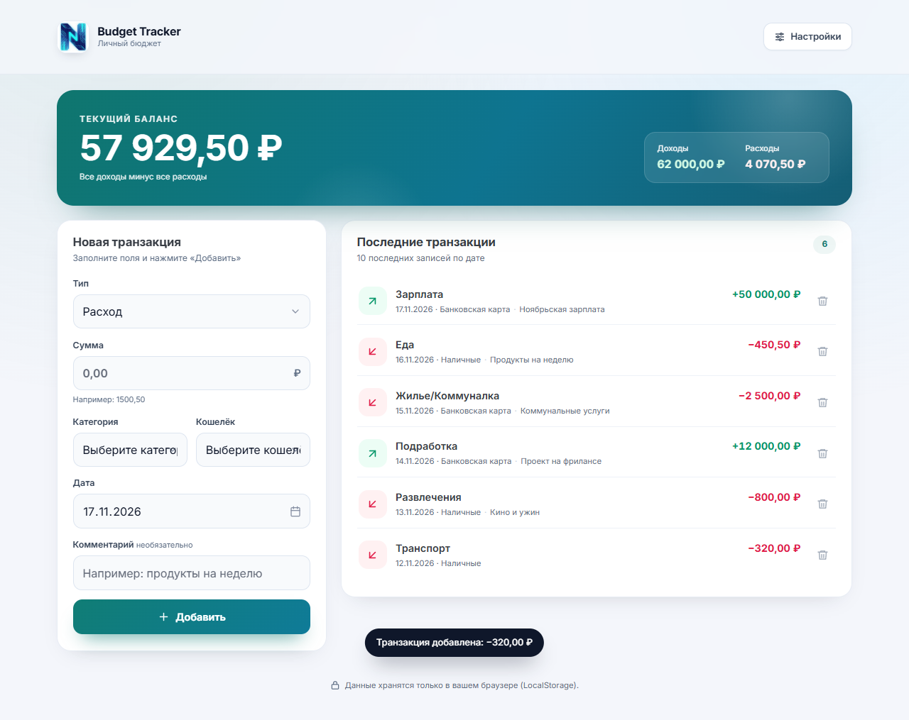

# Budget Tracker

<p align="center">
  
</p>

Простой и быстрый трекер личного бюджета: доходы, расходы, категории, кошельки и текущий баланс. Работает как статический сайт в браузере, данные хранятся локально в `LocalStorage`.



## Возможности

- Добавление транзакций через форму, которая всегда доступна на главном экране.
- Атрибуты транзакции: тип (доход/расход), сумма, категория, дата, комментарий, кошелёк.
- Удаление транзакций кнопкой рядом с записью.
- Текущий баланс: все доходы минус все расходы.
- Список последних 10 транзакций, отсортированный по дате (сначала новые), с прокруткой.
- Стандартные категории и кошельки при первом запуске.
- Добавление и удаление пользовательских категорий и кошельков (стандартные защищены).
- Валидация обязательных полей с помощью стандартного `alert()`.
- Очистка формы после успешного добавления.
- Адаптивная вёрстка для экранов от 320 px.
- Все данные сохраняются в `LocalStorage` и не теряются при перезагрузке страницы.

## Технологии

- **HTML5** — семантическая структура страницы.
- **CSS3** — кастомная тема и адаптивная вёрстка; лёгкий фреймворк [Pico.css](https://picocss.com/) подключён через CDN.
- **JavaScript (ES6+)** — классы `Storage`, `UI`, `BudgetApp` в одном файле `app.js`.
- **LocalStorage** — персистентное хранение данных.

Экспорт и импорт данных не предусмотрены техническим заданием.

## Структура проекта

```text
.
├── index.html              # разметка приложения, форма, список, настройки
├── styles.css              # тема, компоненты, адаптивность
├── app.js                  # Storage, UI, BudgetApp и вся логика
├── logo/
│   ├── logo-mark.png       # логотип для шапки и README
│   ├── logo-64.png         # favicon
│   └── 31a06c8e...jpeg     # исходное изображение
├── preview.png             # скриншот интерфейса для README
├── .github/workflows/pages.yml  # автоматический деплой на GitHub Pages
└── ТЗ2.pdf                 # исходное техническое задание
```

## Запуск локально

Достаточно открыть `index.html` в современном браузере (Chrome, Edge, Firefox, Safari).

Для проверки через локальный сервер (рекомендуется, чтобы `LocalStorage` работал одинаково во всех браузерах):

```bash
npx serve .
```

или любой другой статический сервер, например:

```bash
python -m http.server 8000
```

После запуска откройте `http://localhost:8000`.

> Для загрузки Pico.css и шрифта Inter нужен доступ в интернет. Без CDN приложение останется работоспособным, но потеряет часть оформления.

## Хранение данных

| Ключ | Содержимое |
| --- | --- |
| `budget_transactions` | Массив транзакций |
| `budget_categories` | Объект `{ income: string[], expense: string[] }` |
| `budget_wallets` | Массив кошельков |

Формат транзакции:

```json
{
  "id": "uuid-string",
  "type": "income",
  "amount": 1500.5,
  "category": "Зарплата",
  "date": "2026-11-17",
  "comment": "Ноябрьская зарплата",
  "wallet": "Банковская карта"
}
```

Стандартные категории:

- Доходы: `Зарплата`, `Подработка`, `Подарки`.
- Расходы: `Еда`, `Транспорт`, `Жилье/Коммуналка`, `Развлечения`, `Здоровье`, `Прочее`.

Стандартные кошельки: `Наличные`, `Банковская карта`.

## Публикация на GitHub Pages

В проекте уже есть готовый workflow `.github/workflows/pages.yml`. Он публикует только статические файлы приложения при каждом push в ветку `main`.

1. Создайте репозиторий на GitHub и загрузите файлы проекта в ветку `main`.
2. Откройте **Settings → Pages**.
3. В поле **Source** выберите **GitHub Actions**.
4. Сделайте push в `main` или запустите workflow вручную на вкладке **Actions**.
5. После завершения деплоя сайт будет доступен по адресу `https://<username>.github.io/<repository>/`.

Если предпочитаете деплой без Actions, выберите **Settings → Pages → Deploy from a branch → main / (root)** — приложение полностью статическое и готово к публикации из корня репозитория.

## Проверено

- 42 сценария end-to-end в Chromium: добавление, удаление, баланс, сортировка, лимит 10 записей, категории, кошельки, валидация, сохранение после перезагрузки, адаптивность 320/390 px.
- Аудит доступности axe-core (WCAG 2.1 A/AA) — 0 нарушений на desktop и mobile.
- Нет ошибок в консоли браузера.
